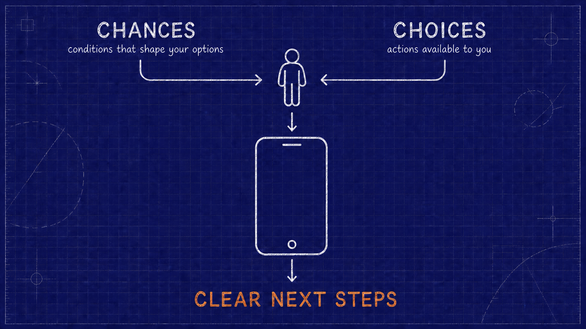

# Starbound Complexity Profile Demo

**Version 0.3.0 · Public prototype**

An interactive prototype showing how the same health or wellbeing question can lead to different guidance when a person's real-life context is considered.

The demo is designed for product demonstrations and concept testing. It is not a diagnostic tool, a clinical decision-support system, or medical advice.



## What the demo shows

Users can:

1. Select social determinants such as cost pressure, unstable housing, transport limitations, caring responsibilities, or difficulty accessing care.
2. Select current behaviours or experiences such as disrupted sleep, missed meals, low energy, medication load, or constant stress.
3. See a live visual summary of the person's current capacity and selected context.
4. Choose an example question or enter a custom health or wellbeing question.
5. Compare a generic answer with an answer adapted to the selected context.
6. See what may be shaping the practicality of the response and which selected factors changed it.

The blueprint overview is a static drawing with an animated knowledge graph embedded inside its phone. The surrounding blueprint remains still while graph connections, profile nodes, and signal particles move. Animation is disabled when the user requests reduced motion.

The future provider view is represented by a teaser only. Aggregated community analysis has not been implemented.

## Experience flow

```text
Select context
      ↓
Build a complexity profile
      ↓
Ask the same question
      ↓
Compare generic and context-aware guidance
      ↓
Explain what changed and what may shape the next step
```

## Complexity profile

Each selectable signal has a small weight. The combined weight places the fictional person on a capacity scale. The visual profile is used to communicate how much practical bandwidth may be available.

The profile is a demonstration setting, not a label or diagnosis. It influences the pace, effort, flexibility, and accessibility of recommendations. The answer text does not use the profile names as a substitute for the person's selected circumstances.

The current profile thresholds and signal weights are defined in `complexity.js`.

## Context-aware answers

The comparison contains:

- **Without context:** general guidance based only on the question.
- **With their context:** guidance adjusted to the selected determinants and behaviours.
- **What may be shaping this:** a cautious explanation of how the selected circumstances may affect access, time, cost, capacity, routine, or feasibility. It does not claim that those circumstances caused a health concern.
- **Why this changed:** the selected signals that materially informed personalisation.

Preset questions have deterministic fallback content. Custom questions are classified into broad topics such as sleep, food, energy, stress, movement, medication, care, injury, or general wellbeing.

## AI and free usage

The demo calls a FastAPI endpoint at:

```text
http://127.0.0.1:8001/api/v1/demo-answer
```

By default, the backend uses Ollama with `gemma3:1b`. The model runs on the local computer, requires no API key, and has no per-request AI API charge. Local compute, storage, and electricity are still used.

The browser never receives an AI provider API key. OpenAI support exists only as an explicit opt-in backend configuration and may incur charges.

If the AI is unavailable, the interface keeps working and shows the local deterministic context-aware fallback.

See [AI_SETUP.md](./AI_SETUP.md) for provider configuration and detailed AI setup. See [PRODUCTION.md](./PRODUCTION.md) before putting the demo on a public URL.

## Safety behaviour

Known urgent phrases are checked in the browser before an AI request is made. Current local safety handling includes:

- Bat or flying-fox bites, scratches, or saliva exposure.
- Severe breathing difficulty, severe chest pain, unconsciousness, overdose, or severe bleeding.
- Language indicating immediate self-harm or suicide risk.

For these cases, immediate safety guidance overrides lifestyle personalisation. The backend prompt also requires urgent Australian safety actions to take priority.

This is prototype-level protection, not comprehensive clinical triage. It must not be treated as a substitute for professional assessment or emergency services. The matcher does not comprehensively cover poisoning, allergic reactions, abuse, violence, sexual-health emergencies, eating-disorder crises, indirect distress language, slang, misspellings, or other urgent situations.

The page permanently displays `000`, Lifeline `13 11 14`, and Kids Helpline `1800 55 1800` above the demo content.

## Accessibility

The target is WCAG 2.2 Level AA. This is not yet a conformance claim because the complete public experience has not undergone an independent audit.

See [ACCESSIBILITY.md](./ACCESSIBILITY.md) for implemented measures, required testing, and known gaps.

## Starbound brand system

The interface follows the visual language used by the main Starbound website:

- Cosmic purple: `#1f0150`
- Warm cream: `#f5e6ca`
- Violet: `#9b5de5`
- Aqua: `#00f5d4`
- Pink: `#ff4da6`
- Typography: Lexend, Inter, and Space Mono
- Star-field imagery and the astronaut bandage logo

The live constellation is the demo's signature visual. Expressive brand treatments are concentrated in the hero and profile, while the question and answer surfaces remain quieter for readability.

## File structure

```text
starbound-site/demo/
├── index.html          Page structure and AI endpoint configuration
├── complexity.css      Responsive layout and Starbound visual system
├── complexity.js       Profile logic, fallback answers, safety checks, and API calls
├── starbound-blueprint-phone-v2.png Static blueprint beneath the live graph overlay
├── starbound-demo.jpg  Current branded demo screenshot
├── README.md           Complete demo documentation
├── AI_SETUP.md         Local AI setup and cost boundary
├── PRODUCTION.md       Hosted architecture and public release controls
├── ACCESSIBILITY.md    WCAG target, current measures, and audit gaps
└── CHANGELOG.md        Prototype versions and notable changes

starbound.mvp/backend/app/
├── api/v1/endpoints/demo_answer.py
├── schemas/demo_answer.py
├── services/demo_answer_service.py
└── core/config.py
```

## Run locally

### 1. Start Ollama

Install Ollama and download the free local model once:

```sh
ollama pull gemma3:1b
```

Ensure Ollama is running on `http://127.0.0.1:11434`.

### 2. Start the backend

From `starbound.mvp/backend`:

```sh
./venv/bin/uvicorn main:app --reload --port 8001
```

### 3. Serve the website

From `starbound-site`:

```sh
python3 -m http.server 8765
```

Open:

```text
http://127.0.0.1:8765/demo/
```

Do not open `index.html` directly as a `file://` URL. Serving it over HTTP avoids browser restrictions and matches the expected setup.

## Configure a different backend

Set the endpoint before `complexity.js` loads:

```html
<script>
  window.STARBOUND_AI_ENDPOINT = "https://example.com/api/v1/demo-answer";
</script>
```

The backend must allow the website origin through CORS.

Outside localhost, the page defaults to a same-origin API at `/api/v1/demo-answer`. This supports a public reverse-proxy configuration without rebuilding the frontend. See [PRODUCTION.md](./PRODUCTION.md) for the recommended hosted architecture, exact-origin CORS, TLS, traffic controls, and release checks.

## Troubleshooting

### AI is unavailable

- Confirm Ollama is running: `ollama list`.
- Confirm `gemma3:1b` is installed: `ollama pull gemma3:1b`.
- Check the backend terminal for a connection or model error.
- Confirm `OLLAMA_BASE_URL` points to the Ollama service.

The demo should continue with a deterministic fallback when AI is unavailable.

### Browser shows a CORS error

- Serve the page over HTTP rather than opening it as `file://`.
- Confirm the page origin is present in `BACKEND_CORS_ORIGINS`.
- For production, use one exact HTTPS origin or a same-origin reverse proxy.

### Port is already in use

Choose another local port and update the related URL. If the API port changes, set `window.STARBOUND_AI_ENDPOINT` before `complexity.js` loads.

### The page still shows an older design or answer

Hard-refresh the browser to invalidate cached CSS and JavaScript, then confirm the static server is serving this directory rather than another copy.

### Requests return 429

The backend permits 20 demo requests per minute per client address. Wait for the `Retry-After` period. Public deployments should enforce a distributed limit at the edge as described in [PRODUCTION.md](./PRODUCTION.md).

## Basic verification

Check the browser JavaScript:

```sh
node --check starbound-site/demo/complexity.js
```

Check the backend module:

```sh
cd starbound.mvp/backend
PYTHONPYCACHEPREFIX=/tmp/starbound_ai_pycache \
  ./venv/bin/python -m py_compile app/services/demo_answer_service.py
```

Recommended manual checks:

- The profile responds when context selections change.
- Reset clears all selected signals.
- Every preset question has a visible label.
- Custom questions produce both answer panels.
- The context explanation refers to the question and selected factors coherently.
- Safety phrases bypass AI personalisation.
- The local fallback appears clearly when the backend is stopped.
- Keyboard focus, mobile layout, and reduced-motion behaviour remain usable.

## Data and privacy

The browser does not save a profile or question. Questions and selected labels are sent to the configured backend when AI generation is requested. With the default local setup, the request remains on the local computer and is sent over local HTTP, not the public internet.

The application code does not deliberately persist question text. This does not by itself guarantee that process managers, reverse proxies, observability tools, hosting platforms, Ollama, or an external AI provider retain nothing. Their logging and retention settings must be reviewed for the actual deployment.

If the backend is deployed remotely, use HTTPS and publish where requests are processed, which providers receive them, what is logged, and how long anything is retained. Do not log request bodies or include health questions in analytics or error traces.

No authentication, database persistence, analytics, provider dashboard, or community aggregation is part of this prototype.

## Known limitations

- The complexity weights and thresholds are demonstration logic and have not been clinically validated.
- The local `gemma3:1b` model is small and can produce awkward or incomplete answers.
- The deterministic topic classifier covers common patterns but cannot understand every possible question.
- Safety phrase detection is deliberately limited and is not comprehensive triage.
- The provider/community view has not yet been built.
- The demo currently depends on Google Fonts when online; system font fallbacks are used if they cannot load.

## Licence and reuse

No open-source licence has been selected for this prototype. Do not assume permission to copy, redistribute, or reuse the code or Starbound brand assets. Choosing and adding a licence is a public-release decision for the project owner.

Version history is recorded in [CHANGELOG.md](./CHANGELOG.md).

## Next phase

The planned provider experience can use aggregated, privacy-preserving context signals to explore barriers, unmet needs, and patterns across communities. That work should define consent, aggregation thresholds, suppression rules, governance, and safeguards before displaying real data.
